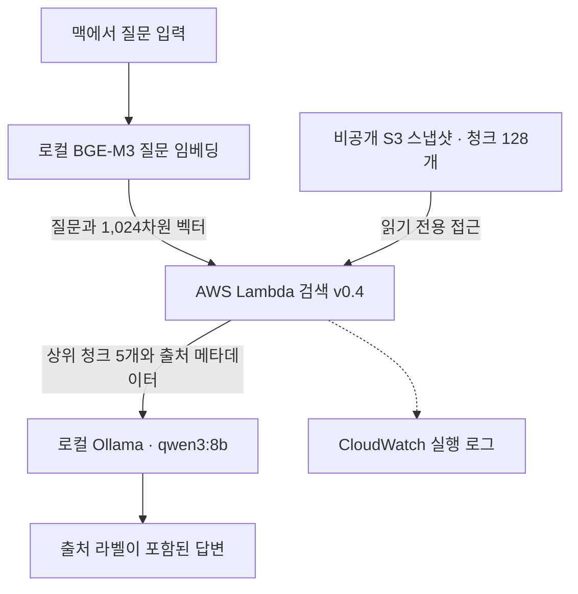

# Project Atlas 2-1 · AWS RAG 마이그레이션

[English](aws-portfolio.md) · [배포 및 테스트](../aws/atlas-aws21/README.md) · [벤치마크 근거](../benchmarks/atlas-aws21/summary.json) · [Git에 추가하는 방법](github-setup.ko.md)

**기존 Databricks 파이프라인의 검색 동작을 AWS에서 재현한 한·영 기술 프로그램 코파일럿입니다.** 검색 계층을 AWS로 이전한 뒤, **고정 평가셋 50문항 모두에서 상위 5개 근거의 순서와 최종 답변 텍스트가 일치**했습니다.

| 검증 항목 | 결과 |
| --- | --- |
| 검색 결과 일치 | **50/50문항**에서 Top 5 근거와 순서가 모두 일치 |
| 답변 일치 | **50/50문항**에서 최종 답변 텍스트가 일치 |
| 검색 품질 | **Recall@5 0.9800**, **MRR 0.8557** 유지 |
| 배포 범위 | 검색은 AWS Lambda와 S3, 임베딩과 답변 생성은 맥에서 실행 |

## 프로젝트 배경

기술 프로그램을 운영하다 보면 여러 이슈의 담당자, 승인 여부, 출시 준비 상태를 한 번에 묻게 됩니다. 답변이 자연스럽더라도 이슈 하나를 빠뜨리거나 오래된 문서를 인용하면 판단을 그르칠 수 있습니다. Project Atlas는 프로젝트 의사결정, 의존 관계, 출시 준비 상태에 관한 한국어와 영어 질문에 문서 근거와 출처를 붙여 답합니다.

이번 프로젝트에서는 **소규모 AWS 구성으로 검색 백엔드를 바꿔도 기존 RAG 동작을 유지할 수 있는지** 검증했습니다. 이전 과정에서 품질이 떨어졌는지 구분할 수 있도록 평가셋, 질문 임베딩 모델, 검색 정책, 생성 모델, 프롬프트를 고정했습니다.

## 아키텍처

| 구성 요소 | Databricks Track A | AWS 구현 |
| --- | --- | --- |
| 벡터 검색 | Databricks AI Search의 근사 최근접 이웃 검색 | Lambda에서 S3 스냅샷을 대상으로 코사인 유사도 전수 검색 |
| 검색 정책 | v0.4 질의 분기, BM25, 가중 RRF, 선택적 재정렬, 다중 식별자 근거 보완 | 같은 정책을 Lambda에서 실행 |
| 모델과 프롬프트 | 로컬 BGE-M3, 로컬 Ollama `qwen3:8b`, 프롬프트 `v0.2.1` | 변경 없음 |
| 검색 데이터와 평가셋 | 청크 128개와 고정 v0.1-full 평가셋 | 같은 스냅샷과 평가셋 사용 |

**설계 결정.** 청크가 128개인 프로토타입에 맞춰 코사인 유사도 전수 검색을 택했습니다. 별도의 검색 서비스를 두지 않아도 되고, 검색 로직을 직접 확인하기 쉽기 때문입니다. S3는 벡터와 메타데이터가 담긴 JSONL 스냅샷을 저장합니다. Lambda는 이를 불러오고, 같은 실행 환경이 유지되는 동안 재사용합니다. 맥에서는 AWS 인증으로 Lambda를 호출하고, Lambda 실행 역할의 읽기 권한은 스냅샷 경로로 제한했습니다. 공개 애플리케이션 엔드포인트나 관리형 답변 생성 서비스는 이 배포에 포함하지 않았습니다.

**검색 동작.** 기술 식별자가 명시되지 않은 질문은 벡터로 검색하고, 질문 의도나 문서 메타데이터를 고려할 필요가 있을 때 순위를 다시 매깁니다. 식별자가 있는 질문은 BM25와 벡터 검색을 함께 사용하고, 가중 RRF(Reciprocal Rank Fusion)로 두 검색 결과의 순위를 결합합니다. 여러 식별자를 묻는 경우에는 각 이슈의 직접 근거를 확보할 수 있다면 최종 결과에 이슈별로 최소 한 개씩 남깁니다. 이슈를 단순히 언급하는 문서와 해당 이슈의 상태를 직접 기록한 문서를 구분하기 위해서입니다.

## 데모 · 한 질문에서 두 이슈의 상태 확인

> AUTH-342와 OBS-119의 현재 상태는 각각 무엇인가?
>
> What is the current status of AUTH-342 and OBS-119, respectively?

AWS는 식별자 기반 하이브리드 검색을 선택했습니다. 로컬 모델은 **AUTH-342는 고객 보안 승인 대기로 구현이 시작되지 않았고**, **OBS-119는 프로덕션 구성이 준비됐지만 최종 검증은 끝나지 않았다**고 답했습니다. 각 주장에는 해당 이슈의 직접 근거가 인용됐습니다.

| 인용한 출처 | Top 5에 포함된 이유 | 뒷받침한 내용 |
| --- | --- | --- |
| `[S5]` · `engineering_issue_auth342::chunk::001` | BM25가 찾은 후보를 다중 식별자 근거 보완 로직이 최종 결과에 포함 | 고객 보안 아키텍처 위원회 승인이 아직 나지 않아 엔지니어링 구현이 시작되지 않음 |
| `[S3]` · `engineering_issue_obs119::chunk::001` | 벡터 검색 후보에 없던 청크를 BM25가 찾아냄 | 프로덕션 구성은 준비됐지만 최종 프로덕션 검증은 미완료 |

이전 후에도 두 이슈의 직접 근거가 모두 Top 5에 남았습니다. 두 식별자가 한 문서에 등장하더라도, 한 이슈의 상태를 직접 설명하는 근거가 빠지면 질문에 온전히 답하기 어렵습니다. 이 사례는 그런 누락을 막는 기존 검색 정책이 AWS에서도 작동했음을 보여줍니다.

## 평가 결과

2026년 11월 AWS 실행 결과를 저장된 Databricks Track A 결과와 문항 ID별로 대조했습니다. 50문항에는 한국어, 영어, 교차 언어 사례가 포함됐습니다. AWS에서 **벡터 검색 41문항, 식별자 하이브리드 검색 9문항**을 처리했고, **37문항**에는 재정렬이 적용됐습니다. 평균 점수만 비교하지 않고 각 문항의 청크 ID 순서와 답변 텍스트를 직접 확인했습니다.

| 지표 | Databricks Track A | AWS |
| --- | ---: | ---: |
| Recall@1 | 0.7300 | 0.7300 |
| Recall@5 | 0.9800 | 0.9800 |
| 평균 역순위(MRR) | 0.8557 | 0.8557 |
| 유효한 출처 라벨을 사용한 답변 | 50/50 | 50/50 |
| 과거 시점 질문에서 기준일 이후 출처를 인용한 사례 | 0/9 | 0/9 |
| 현재 상태 질문에서 대체된 문서를 인용한 사례 | 0/19 | 0/19 |
| 수동 검토 대상으로 표시된 답변 | 10/50 | 10/50 |

**응답 시간.** 검색 평가에서 Lambda 내부의 검색 및 정책 적용은 평균 **40.3 ms**, 맥에서 AWS CLI로 호출하고 응답을 받기까지는 평균 **999.3 ms**였습니다. 후자에는 CLI 시작, 네트워크, 발생한 Lambda 초기화 시간이 포함됩니다. 두 수치는 측정 범위가 다르며, Databricks 서버 내부 검색 시간과 직접 비교할 수 없습니다. 이번 평가는 기능 검증이 목적이었으며, 처리량이나 비용은 평가하지 않았습니다.

### 평가의 한계

- **결과가 같다고 정답이라는 뜻은 아닙니다.** `FULL-CHAL-007`의 담당 범위 질문에서 두 백엔드 모두 정답으로 지정된 근거를 Top 5에 포함하지 못했습니다. 두 답변 모두 기대 답변의 ‘고객 보안팀(Customer Security)’보다 넓은 표현인 ‘고객(the customer)’을 사용했습니다.
- **출처 라벨이 유효하다고 주장이 입증된 것은 아닙니다.** 라벨 검사는 인용한 라벨이 제공된 문맥에 실제 존재하는지 확인합니다. 인용 문서가 해당 주장을 뒷받침하는지는 근거를 별도로 검토해야 합니다.
- **수동 검토 비율은 오답률이 아닙니다.** 두 환경에서 같은 10문항이 표시됐습니다. 한 답변은 출시 목표일을 정확히 말했는데도 짧은 기준 답변과의 유사도가 낮게 나왔습니다. 의미 유사도 점수는 검토 우선순위를 정하는 데 도움이 되지만, 사실 정확도를 판정하지는 않습니다.
- **검증 범위는 제한적입니다.** 결과는 고정 50문항과 청크 128개의 스냅샷에 한정됩니다. 프로덕션 규모의 성능, 모든 질문에서의 일치, 시스템 전체의 AWS 호스팅을 입증하지는 않습니다.

## 재현 방법

이 저장소에서 바로 실행할 수 있는 예제는 [시작 안내](../README.ko.md#빠른-실행)를 참고하세요. AWS와 모델 없이 실행하는 공개 모의 데모와, 기존 Lambda를 호출해 Ollama로 답변을 만드는 예제를 제공합니다.

원래 50문항을 다시 실행하려면 기존 Portfolio 2 환경의 고정 평가셋, 원본 S3 스냅샷, 저장된 Databricks 결과가 필요합니다. 공개용 저장소에는 이 자료를 포함하지 않았습니다. [원본 벤치마크 재현 조건](../benchmarks/historical/README.md)과 [공개용 평가 결과](../benchmarks/atlas-aws21/summary.json)를 참고하세요.

## 프로젝트에서 확인한 점

이번 마이그레이션의 성공 기준은 **백엔드를 바꾼 뒤에도 사용자가 받는 검색 근거와 답변을 유지하는 것**이었습니다. 고정 평가셋 덕분에 평균 점수가 같다는 사실을 넘어, 50문항 각각의 Top 5 순위와 최종 답변이 일치했는지 확인할 수 있었습니다. 동시에 기존 파이프라인에서 놓치고 있던 사례도 그대로 드러났습니다.
