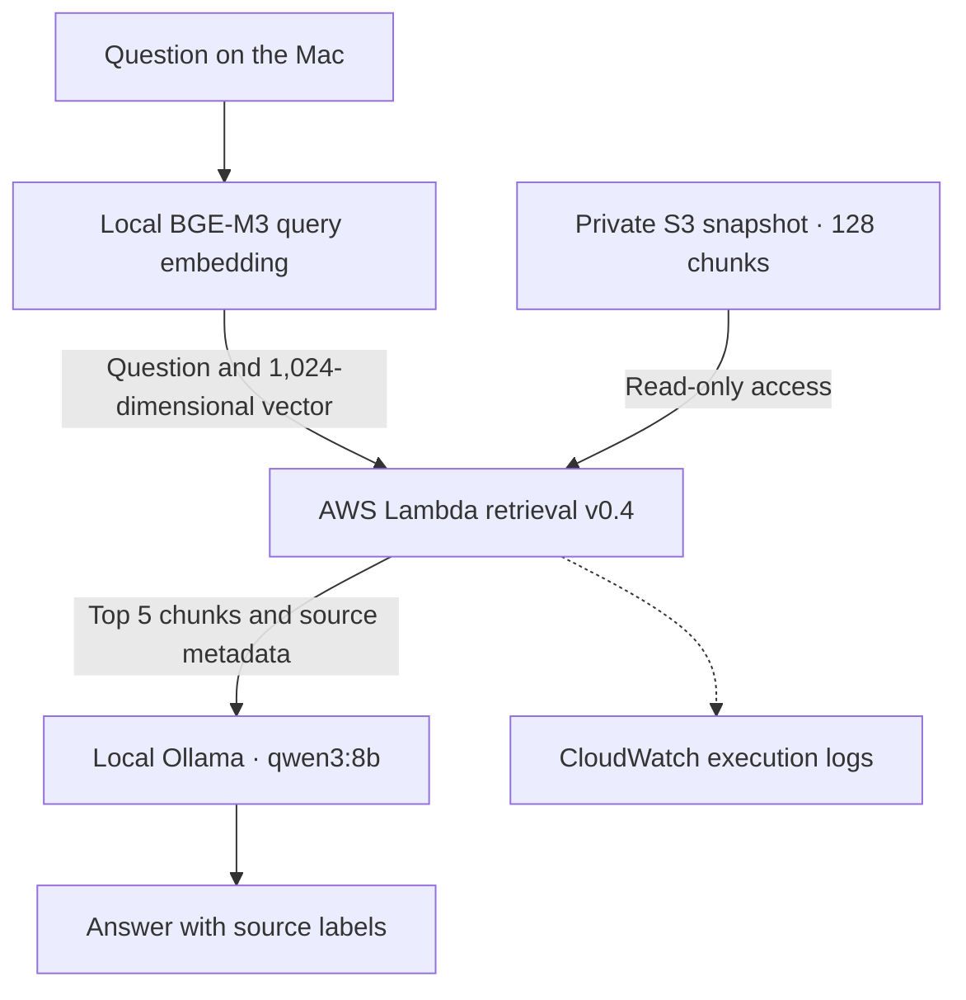

# Project Atlas 2-1 · AWS RAG Migration

[한국어](aws-portfolio.ko.md) · [Deployment and tests](../aws/atlas-aws21/README.md) · [Benchmark evidence](../benchmarks/atlas-aws21/summary.json)

**A bilingual technical-program copilot that reproduced the existing Databricks pipeline on a different retrieval backend.** Migrating retrieval to AWS preserved the exact Top 5 evidence order and the generated answer text on all **50 frozen evaluation questions**.

| | Verified result |
| --- | --- |
| Retrieval agreement | **50/50** exact Top 5 order matches |
| Answer agreement | **50/50** exact answer-text matches |
| Retrieval quality | **0.9800 Recall@5** and **0.8557 MRR**, unchanged |
| Deployment scope | Retrieval on AWS Lambda and S3. Embedding and generation on a Mac. |

## Why this project

Technical-program questions often combine issues that have different owners, approvals, and readiness states. A fluent answer can still be misleading if it omits one issue or cites an outdated source. Project Atlas answers Korean and English questions about project decisions, dependencies, and release readiness using labeled document evidence.

The migration asked **whether a small AWS deployment could preserve the behavior of an existing RAG pipeline after replacing its search backend**. I kept the evaluation set, query embedder, retrieval policy, model, and prompt fixed so the benchmark could detect migration regressions.

## Architecture

| Component | Databricks Track A | AWS implementation |
| --- | --- | --- |
| Dense search | Databricks AI Search approximate nearest-neighbor retrieval | Exact cosine search in Lambda over the S3 snapshot |
| Retrieval policy | v0.4 routing, BM25, weighted RRF, selective reranking, and multi-ID coverage | Same policy, now executed in Lambda |
| Model and prompt | Local BGE-M3, local Ollama `qwen3:8b`, prompt `v0.2.1` | Unchanged |
| Corpus and benchmark | 128 chunks and the frozen v0.1-full question set | Same snapshot and evaluation set |

**Design decisions.** Exact cosine search was a deliberate choice for 128 chunks. It avoided a separate search service in this prototype and kept the dense search implementation easy to inspect. S3 stores the JSONL snapshot, including vectors and metadata. Lambda loads it and reuses it while the execution environment is warm. The Mac invokes Lambda with AWS authentication, and the Lambda execution role has read access scoped to the snapshot prefix. No public application endpoint or managed generation service is part of this deployment.

**Retrieval behavior.** Queries without explicit technical IDs use dense search, with reranking when intent or metadata signals apply. Queries with IDs use BM25 and dense search, fused by weighted reciprocal rank fusion (RRF). For multi-ID questions, v0.4 also keeps at least one direct source per ID in the final results when coverage is feasible. This distinguishes a document about an issue from a document that merely mentions it.

## Demo · One question, two independent issues

> AUTH-342와 OBS-119의 현재 상태는 각각 무엇인가?
>
> What is the current status of AUTH-342 and OBS-119, respectively?

The AWS pipeline selected the identifier-hybrid route. The local model answered that **AUTH-342 implementation had not started because customer security approval was still pending** and that **OBS-119 production configuration was ready but final production validation was not complete**. It cited the direct issue source for each claim.

| Cited source | How it entered the Top 5 | What it supported |
| --- | --- | --- |
| `[S5]` · `engineering_issue_auth342::chunk::001` | BM25 candidate retained by multi-ID coverage | Customer Security Architecture Board approval was still pending. Engineering implementation had not started. |
| `[S3]` · `engineering_issue_obs119::chunk::001` | BM25 candidate absent from the dense candidate list | Production configuration was ready. Final production validation was incomplete. |

Both issues had direct evidence in the final Top 5. This is the behavior the migration needed to retain. Finding passages about both IDs was not enough if one issue's own status source fell out of the final results.

## Evaluation

The November 2026 AWS run was compared with saved Databricks Track A results by question ID. The 50 questions included Korean, English, and cross-language cases. The AWS run exercised **41 dense routes, nine identifier-hybrid routes, and 37 reranked cases**. Exact agreement was checked on ordered chunk IDs and answer strings, not inferred from equal aggregate scores.

| Metric | Databricks Track A | AWS |
| --- | ---: | ---: |
| Recall@1 | 0.7300 | 0.7300 |
| Recall@5 | 0.9800 | 0.9800 |
| Mean reciprocal rank (MRR) | 0.8557 | 0.8557 |
| Valid citation labels | 50/50 | 50/50 |
| Past-date questions citing a source after the requested date | 0/9 | 0/9 |
| Current-state questions citing a superseded source | 0/19 | 0/19 |
| Answers flagged for manual review | 10/50 | 10/50 |

**Timing.** On the retrieval evaluation, the AWS search and policy stages averaged **40.3 ms inside Lambda**, while the Mac's AWS CLI round trip averaged **999.3 ms**. These measure different boundaries. The round trip includes CLI startup, network, and any Lambda initialization. Neither figure is a direct comparison with Databricks server-only search time. This was a functional benchmark, not a throughput or cost study.

### What the benchmark does not prove

- **Agreement is not accuracy.** On `FULL-CHAL-007`, both backends missed the labeled Top 5 evidence for an ownership-boundary question. Both answers said “the customer” where the expected answer specified “Customer Security.”
- **A valid label is not proof of support.** The label check confirms that cited labels exist in the supplied context. Manual evidence checks are still needed to establish whether each claim is supported.
- **Review flags are not an error rate.** The same 10 answers were flagged in both runs. One answer correctly stated the launch date yet received a low similarity score against a short reference answer. Automated semantic similarity is a triage aid, not a factual correctness verdict.
- **Scope is intentionally small.** The evidence is limited to the frozen 50-query suite and 128-chunk snapshot. It does not establish production-scale performance, universal parity, or whole-system AWS hosting.

## Reproduce the checks

See the [repository quick start](../README.md#quick-start) for the model-free synthetic demo and the live AWS-to-Ollama example. The public synthetic corpus is separate from the historical benchmark corpus.

Replaying the original 50 questions requires the legacy Portfolio 2 environment, the frozen question set, the original S3 snapshot, and the saved Databricks references. Those data artifacts do not ship in this repository. See the [historical rerun instructions](../benchmarks/historical/README.md) and the [public benchmark summary](../benchmarks/atlas-aws21/summary.json).

## Takeaway

For this migration, the success criterion was **preserving user-facing behavior after a backend change**, not adding more cloud services. The frozen benchmark showed that agreement extended beyond aggregate metrics to every Top 5 ranking and answer in the suite. It also documented where the original pipeline still fell short.
